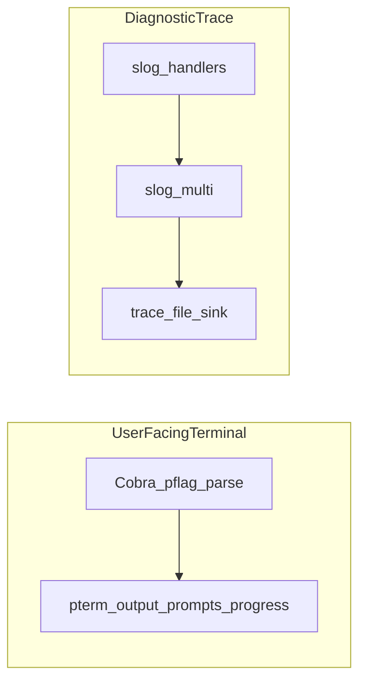

# ADR-26101701: Выбор технологического стэка

**Статус:** ✅ **Принято**

## Контекст

[Git Herder][product-intent-readme] — CLI для массовых операций над git-репозиториями и
локальными рабочими копиями. Продукт предполагает большое дерево команд и опций,
автогенерируемую справку `--help` из кода и сквозные способности: обратная связь в
терминале [cap.terminal-feedback][terminal-feedback], журнал выполнения
[cap.operation-trace][operation-trace], именованные профили
[cap.profiles][profiles].

Перед первым кодом в прикладном репозитории нужно зафиксировать единый
технологический стек слоя «интерфейс командной строки + терминал + диагностика +
файловый конфиг», чтобы не пересматривать парсинг, вывод и загрузку профилей при
росте числа команд.

Ограничение: этот ADR описывает **выбор библиотек и границы ответственности**, а не
пользовательский контракт CLI (коды завершения, semver, семантика array-флагов,
приоритет CLI → env → профиль). Эти правила относятся к прикладной спецификации
CLI и capability профилей, не к ADR.

## Решение

Прикладной код Git Herder реализуется на **Go** в модуле
`github.com/Snowbridge/git-herder`. Ниже — принятые библиотеки и разделение ролей.

### Язык и версия Go

| Решение | Значение |
| ------- | -------- |
| Язык | Go |
| Module path | `github.com/Snowbridge/git-herder` |
| Поддерживаемые версии Go | **Последние два minor-релиза** официальной ветки Go |

При выходе нового minor-релиза Go команда обновляет минимальную поддерживаемую
версию и baseline в CI (конкретный pin в `go.mod` и пайплайнах — решение
реализации, не этот ADR). Layout каталогов (`cmd/`, `internal/` и т.д.) этим ADR
не задаётся.

### CLI: cobra и pflag

- **[cobra](https://github.com/spf13/cobra)** (`github.com/spf13/cobra`) — дерево
  команд и подкоманд, встроенная справка `--help`, основа для shell completion
  (поставка completion в релиз не обязательна в MVP).
- **[pflag](https://github.com/spf13/pflag)** (`github.com/spf13/pflag`) — длинные и
  короткие флаги, в том числе повторяемые (array). Семантика «повтор флага» vs
  «значения через запятую» и единые правила для всего продукта — в прикладной
  спецификации CLI, не здесь.

Парсинг аргументов и текст help остаются ответственностью cobra/pflag; оформление
help через отдельные TUI-библиотеки не требуется.

### Терминал: pterm

- **[pterm](https://github.com/pterm/pterm)** (`github.com/pterm/pterm`) — **весь**
  вывод в интерактивный терминал для пользователя: сообщения о ходе работы, ошибки
  для пользователя, прогресс, таблицы, интерактивные запросы (prompts).

Схема ответственности:

### Логирование: log/slog и slog-multi

- Базовый API: стандартная библиотека **`log/slog`**.
- **[slog-multi](https://github.com/samber/slog-multi)** (`github.com/samber/slog-multi`)
  — композиция нескольких `slog.Handler` (например, запись журнала запуска в файл
  во временной области ОС в духе [cap.operation-trace][operation-trace]).

Политика:

- **pterm** — канал для человека в терминале.
- **slog** (через slog-multi) — структурированная диагностика и журнал выполнения
  в sink(ах), не предназначенных для дублирования того же текста, что уже выведен
  через pterm (формат файла, redaction секретов, срок хранения — прикладная
  спецификация).

### Конфигурация на диске: viper и YAML

- **[viper](https://github.com/spf13/viper)** (`github.com/spf13/viper`) — чтение
  **YAML**-файлов профилей и конфигурации Git Herder на диске.

Viper в этом ADR ограничен **файловым слоем YAML**. Полный порядок слияния значений
(CLI, переменные окружения, профиль, дефолты) не фиксируется здесь — он следует из
[cap.profiles][profiles] и прикладной спецификации платформы.

### Отложено (отдельные ADR)

Следующие решения **не** входят в этот ADR:

- взаимодействие с **git** (вызов бинаря в `PATH` vs `go-git` vs гибрид);
- **HTTP-клиент** и стек вызовов SCM API.

## Аргументация

| Альтернатива | Почему не выбрана |
| ------------ | ----------------- |
| Kong, urfave/cli v3 | Меньше привычной экосистемы для глубокого дерева команд и persistent flags; cobra — де-факто стандарт для CLI уровня kubectl/gh |
| `flag` (stdlib) без cobra | Недостаточно для масштаба субкоманд и единого help |
| lipgloss/bubbletea, survey/huh, только `fmt` | pterm покрывает прогресс, таблицы и prompts одной зависимостью; полноценный TUI не соответствует замыслу CLI |
| logrus, zap | `slog` — стандарт Go; slog-multi даёт tee без собственной обёртки |
| slog без multi | Понадобится несколько sink'ов для журнала trace; multi явно моделирует композицию handler'ов |
| koanf, только gopkg.in/yaml | viper достаточен для YAML профилей; узкий scope снижает риск «магии» viper на всю конфигурацию |
| env-only конфиг | Не покрывает именованные профили на диске из [cap.profiles][profiles] |

## Последствия

### Позитивные

- Единый паттерн для контрибьюторов OSS: cobra для команд, pterm для UX, slog для
  разбора инцидентов.
- Справка `--help` остаётся производной от регистрации команд в коде.
- Разделение терминального вывода и структурированного журнала согласуется с
  [cap.terminal-feedback][terminal-feedback] и [cap.operation-trace][operation-trace].

### Негативные

- Зависимость от активности и качества pterm; поведение без TTY (CI, пайпы) нужно
  явно тестировать (отключение ANSI, подмена writer).
- Cobra добавляет boilerplate при большом числе команд.
- Viper требует дисциплины: не расширять его на merge с флагами без явного дизайна
  в коде.

### Компромиссы

- Три слоя (cobra/pflag, pterm, slog) — coding guidelines в прикладном репозитории
  появятся позже, не в ADR.
- Shell completion и man pages — опционально после MVP.
- Git и HTTP SCM — отдельные ADR, чтобы не блокировать старт CLI-каркаса.

## Ссылки

- [Замысел продукта Git Herder][product-intent-readme]
- [Обратная связь в терминале][terminal-feedback]
- [Трассировка выполнения][operation-trace]
- [Профили Git Herder][profiles]
- [Замысел продукта (термин)][product-intent-term]

<!-- LINKS -->
[product-intent-readme]: ../documentation/product-intent/README.md
[terminal-feedback]: ../documentation/product-intent/capability/platform/terminal-feedback.md
[operation-trace]: ../documentation/product-intent/capability/platform/operation-trace.md
[profiles]: ../documentation/product-intent/capability/platform/profiles.md
[product-intent-term]: ../glossary/terms/product-intent.md
