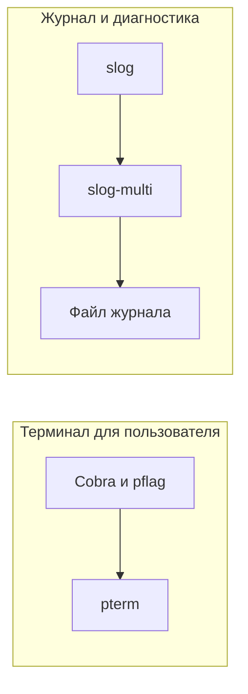

# ADR-26101701: Стек прикладного кода на Go

## Статус

✅ **Принято**

## Контекст

[Git Herder][product-intent-readme] — CLI для массовых операций над git-репозиториями и
локальными копиями. В продукте много команд и опций, справка `--help` строится из
кода. Сквозные способности: [обратная связь в терминале][terminal-feedback],
[журнал выполнения][operation-trace], [именованные профили][profiles].

Перед первым кодом нужно выбрать один стек для слоя «командная строка + терминал +
диагностика + конфиг в файлах». Вызов git на хосте и HTTP к SCM — в отдельных ADR:
[ADR-26101702][adr-git], [ADR-26101703][adr-http].

Иначе при росте числа команд придётся заново менять разбор аргументов, вывод и
загрузку профилей.

Этот ADR фиксирует **библиотеки и зоны ответственности**. Он **не** описывает
контракт CLI для пользователя: коды выхода, semver, повторяемые флаги, порядок
«аргументы → переменные окружения → профиль». Это задача прикладной спецификации
CLI и capability профилей.

## Решение

Код Git Herder пишем на **Go**, модуль `github.com/Snowbridge/git-herder`.
Ниже — принятые пакеты и кто за что отвечает.

### Язык и версия Go

| Что | Значение |
| --- | -------- |
| Язык | Go |
| Путь модуля | `github.com/Snowbridge/git-herder` |
| Версии Go | Поддерживаем **два последних minor-релиза** официальной ветки Go |

Когда выходит новый minor Go, команда поднимает минимальную поддерживаемую версию и
настройки CI. Конкретная версия в `go.mod` и пайплайнах — не предмет этого ADR.
Структуру каталогов (`cmd/`, `internal/` и т.д.) этот ADR не задаёт.

### CLI: cobra и pflag

- **[cobra](https://github.com/spf13/cobra)** — дерево команд и подкоманд, справка
  `--help`, основа для автодополнения в shell.
- **[pflag](https://github.com/spf13/pflag)** — длинные и короткие флаги, в том
  числе с несколькими значениями. Правила «повторить флаг» и «значения через
  запятую» задаём в прикладной спецификации CLI, не здесь.

Разбор аргументов и текст help — у cobra и pflag. Оформлять help отдельной
TUI-библиотекой не требуется.

### Терминал: pterm

- **[pterm](https://github.com/pterm/pterm)** — **весь** вывод пользователю в
  терминал: ход работы, ошибки, прогресс, таблицы, запросы ввода.

Кто за что отвечает:

### Логирование: log/slog и slog-multi

- API: стандартная библиотека **`log/slog`**.
- **[slog-multi](https://github.com/samber/slog-multi)** — несколько обработчиков
  `slog` (например, запись журнала запуска во временный файл ОС, как в
  [cap.operation-trace][operation-trace]).

Правила:

- **pterm** — то, что видит человек в терминале.
- **slog** (через slog-multi) — структурированная диагностика и журнал выполнения.
  Вывод для пользователя через pterm дублируется в журнал выполнения. Формат файла,
  скрытие секретов и срок хранения — в прикладной спецификации.

### Конфиг в файлах: viper и YAML

- **[viper](https://github.com/spf13/viper)** — чтение **YAML**-файлов профилей и
  общего конфига Git Herder на диске.

Порядок слияния значений из CLI, переменных окружения, профиля и значений по умолчанию
устанавливается в прикладной спецификации платформы.

## Аргументация

| Вариант | Почему отказались |
| ------- | ----------------- |
| Kong, urfave/cli v3 | Слабее привычная экосистема для глубокого дерева команд и наследуемых флагов; cobra — обычный выбор для CLI уровня kubectl и gh |
| `flag` без cobra | Мало для большого числа подкоманд и единой справки |
| lipgloss/bubbletea, survey/huh, только `fmt` | pterm закрывает прогресс, таблицы и запросы одной зависимостью; полноэкранный TUI не вписывается в замысел CLI |
| logrus, zap | `slog` — стандарт Go; slog-multi даёт несколько приёмников без своей обёртки |
| slog без multi | Журналу трассировки нужно несколько приёмников записи |
| koanf, только gopkg.in/yaml | viper хватает для YAML профилей; узкая роль снижает риск «магии» viper на весь конфиг |
| Только переменные окружения | Не покрывает именованные профили на диске из [cap.profiles][profiles] |

## Последствия

### Позитивные

- Один понятный расклад для контрибьюторов: cobra — команды, pterm — интерфейс в
  терминале, slog — разбор сбоев.
- Справка `--help` всегда совпадает с регистрацией команд в коде.
- Разделение терминала и журнала согласуется с [terminal-feedback][terminal-feedback]
  и [operation-trace][operation-trace].

### Негативные

- Зависимость от развития pterm; без TTY (CI, пайпы) поведение нужно проверять
  отдельно — отключение ANSI, подмена вывода.
- У cobra много шаблонного кода при большом числе команд.
- Viper нельзя раздувать: слияние с флагами — только с явным дизайном в коде.

### Компромиссы

- Три слоя (cobra/pflag, pterm, slog) — правила кода в прикладном репозитории
  появятся позже, не в ADR.
- Автодополнение в shell и man-страницы — после первой поставки, по желанию.

<!-- LINKS -->
[adr-git]: ADR-26101702-host-git-from-path.md
[adr-http]: ADR-26101703-scm-http-client-wrapper.md
[product-intent-readme]: ../documentation/product-intent/README.md
[terminal-feedback]: ../documentation/product-intent/capability/platform/terminal-feedback.md
[operation-trace]: ../documentation/product-intent/capability/platform/operation-trace.md
[profiles]: ../documentation/product-intent/capability/platform/profiles.md
