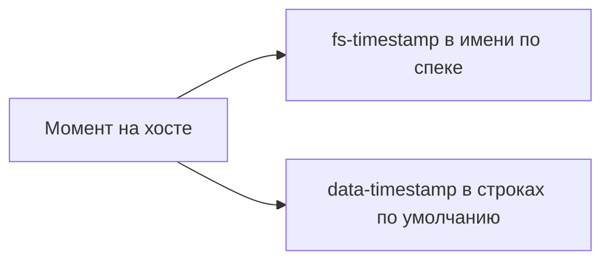

# ADR-26101704: Два формата меток времени

## Статус

✅ **Принято**

## Контекст

[Git Herder](../documentation/product-intent/README.md) пишет [журнал выполнения](../documentation/product-intent/capability/platform/operation-trace.md) и другие
артефакты на диск; в записях журнала и в данных фигурируют метки времени. Стек
диагностики включает `log/slog` и запись файла во временной области ОС
([ADR-26101701](ADR-26101701-go-application-stack.md)).

Имя файла или каталога и поле в записи журнала решают **разные задачи**. В путях на
диске символ `:` в ISO-времени **недопустим** на части ОС (в том числе Windows). В
строковых полях двоеточия в времени и в смещении соответствуют ISO 8601 и ожидаются
парсерами.

Нужно одно соглашение платформы: когда какой профиль обязателен, без смешения
форматов в одной роли (имя ≠ поле данных).

Полный шаблон имени журнала, схема JSON-записей и маскировка секретов описываются в
прикладной спецификации платформы. Этот ADR задаёт **только** два канонических профиля
метки времени.

## Решение

Вводим два именованных профиля. В спеках и коде на них ссылаются по коротким именам
**fs-timestamp** и **data-timestamp**.

Общее для обоих:

- момент задаётся как **локальное время хоста** с явным смещением от UTC;
- по умолчанию **не** используем суффикс `Z` и не переводим момент в UTC только ради
строки;
- календарная дата `YYYY-MM-DD`, между датой и временем ставится буква `T`;
- при смене часового пояса или переходе на летнее/зимнее время во время работы
процесса каждая метка фиксирует момент **в момент записи**; пересчёт прошлых меток
не требуется.



### fs-timestamp для имён файлов и каталогов

**Когда обязателен:** Git Herder создаёт файл или каталог, и **прикладная спека**
явно включает метку времени в имя. ADR не перечисляет все такие артефакты.

**Шаблон:**

```text
YYYY-MM-DDTHH-mm-ss.mmmm±HHMM
```

| Часть | Правило |
| ----- | ------- |
| Дата | `YYYY-MM-DD` |
| Время | `HH-mm-ss` (дефисы вместо двоеточий) |
| Дробная секунда | `.` + 4 цифры (миллисекунды и нулевой разряд справа) |
| Смещение | `±HHMM` без двоеточия |

**Пример:** `2026-08-23T21-33-56.1230+0300`.

Один и тот же календарный момент в **data-timestamp** и в **fs-timestamp** **не
обязан** совпадать посимвольно (разная длина дробной части и разный вид смещения).
Из одного значения времени в коде получают обе строки двумя layout’ами.

#### Коллизии имён

Если два объекта получили бы **одинаковую** строку fs-timestamp в имени (в пределах
одной миллисекунды на хосте), различают суффиксом `-2`, `-3`, … по возрастанию.

| Тип объекта | Куда вставлять суффикс |
| ----------- | ---------------------- |
| Файл с расширением | Непосредственно **перед** финальным расширением (последняя точка в имени файла) |
| Каталог или файл без расширения | В **конец** имени каталога или файла |

**Примеры:**

- При коллизии имя `…1230+0300.log` заменяют на `…1230+0300-2.log`.
- При коллизии имя `…1230+0300.json` заменяют на `…1230+0300-2.json`.
- При коллизии каталог `run-2026-08-23T21-33-56.1230+0300` переименовывают в
`run-2026-08-23T21-33-56.1230+0300-2`.

Суффикс коллизии **не** является частью профиля fs-timestamp; это правило
разведения имён на диске.

### data-timestamp для полей данных и строк в продукте

**Когда обязателен:** все **строковые** метки времени в продукте **по умолчанию**,
пока прикладная спека **явно не указала иное** (например, внешний контракт SCM API).

**Шаблон (ISO 8601, локальное время с offset):**

```text
YYYY-MM-DDTHH:mm:ss.sss±HH:mm
```

**Пример:** `2026-08-28T12:49:00.123+03:00`.

В structured-данных (в том числе JSON журнала) значение задаётся **строкой**, а не числом
epoch.

К этому профилю относятся, в частности: поля времени в записях `slog`, поле времени
при дублировании диагностики на консоль, прочие строковые метки в выводе и данных
утилиты, если спека не задала другой формат.

## Аргументация

| Альтернатива | Почему не выбрана |
| ------------ | ----------------- |
| Один RFC3339 / ISO 8601 везде, в том числе в именах | `:` в компонентах времени и смещения ломает имена на Windows |
| UTC (`Z`) по умолчанию | Нужно локальное время хоста со смещением в строке |
| Одна строка ISO с заменой `:` на `-` | Путаница при парсинге; смешение ролей «имя» и «поле» |
| Unix epoch в именах файлов | Хуже читается при ручном разборе во временном каталоге ОС |

## Последствия

### Позитивные

- Имена файлов и каталогов переносимы между ОС.
- Поля данных единообразны для парсеров и для человека.
- Авторам спек ясно: для timestamp в имени применяют **fs-timestamp**. Для строки в
данных по умолчанию применяют **data-timestamp**, если спека не оговорила иное.

### Негативные

- В коде и тестах два layout’а и правило коллизий для имён.
- Риск ошибочного формата в новом поле без проверки по спеке.

### Компромиссы

- Мы осознанно используем четыре дробных знака в fs-timestamp и три в data-timestamp.
Таблицы полей журнала и redaction здесь не дублируем: это прикладная спецификация.
- Термины в глоссарии для этих профилей вводим отдельно при необходимости. Каноном
формата служит этот ADR.
